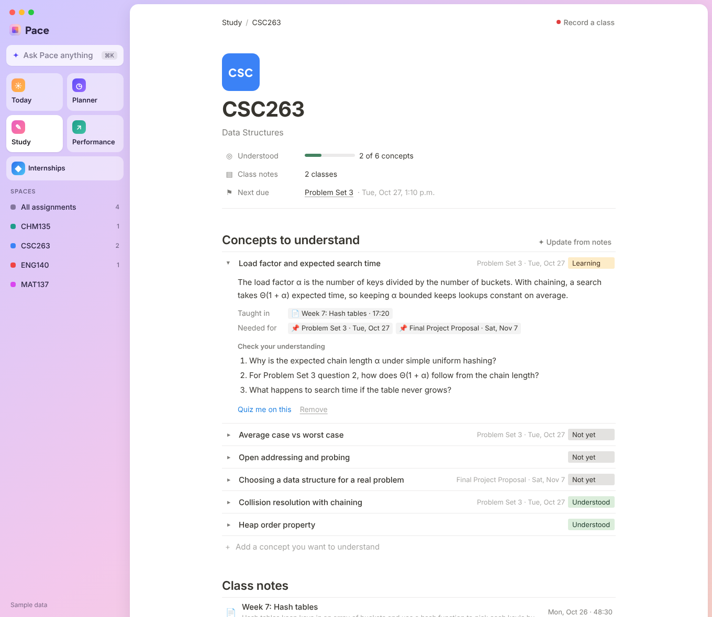
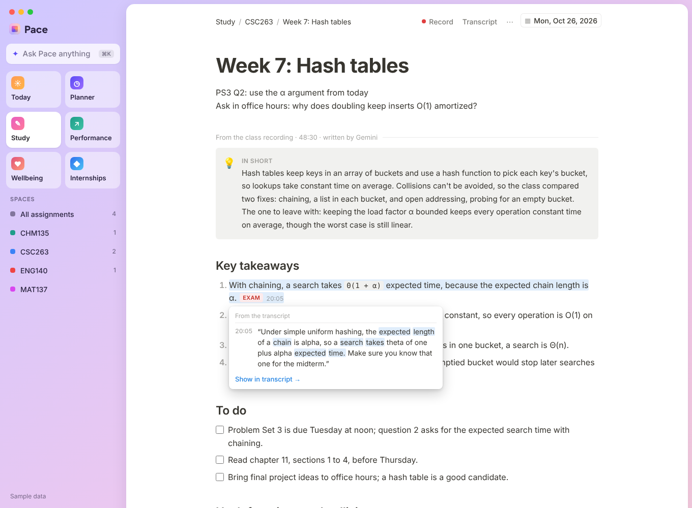

# Pace: your AI study team

Pace connects to Quercus (UofT's Canvas) and gives every student a small team of **AI agents, powered by Google Gemini**. They plan your week around your real life, keep your notes for every course (recording a class turns it into notes you can trace back to the lecture), and measure how well you actually know each topic. Deadlines are only the starting point.

Built for **Hack the Valley 11**. Runs entirely on free tiers: Gemini API free tier, Vercel Hobby, the Google Sheets API and Resend free.


## The agents

| Agent | What it does | How |
| --- | --- | --- |
| **Command bar** (⌘K) | One box for everything: "I work Tuesday 5 to 10", "Open my CSC263 notes", "Quiz me on heaps". | Gemini **function calling** picks the right agent and extracts its arguments, then the app runs it. |
| **Planner** | Fits every assignment step into the hours you have each day. Takes plain-English changes to your week. Flags crunch days, missing rest days and deadlines that won't fit, and writes a weekly coaching note. | Deterministic earliest-deadline-first scheduler in Toronto time. Gemini turns your message into per-day hour changes (structured output). |
| **Study** | Your notes, one list per course in date order. A note is a clean page you type on, with its date in the top right corner: change the date and the note moves to its place in the list. Press **Record** on any note to record the class while you write (see below). | Notes save as you type. Recorded classes are transcribed and written up by Gemini, with every line keeping its transcript source. |
| **Performance** | Reads your real Quercus grades per course (average, trend, late and missed work) and your topic mastery, then tells you where to focus. Quizzes you on any topic to measure proficiency. | Gemini writes 5-question quizzes graded in the browser. Mastery is a weighted moving score per topic. Gemini writes insights from the numbers. |
| **Career agent** (Internships) | Tracks practicum, internship, co-op and conference applications. A list split into **Priority** (starred, soonest deadline first) and **By relevance** (ranked by fit with your background and location). Each opportunity gets a dated application plan (what to prioritize, which parts of your background to lead with, what's easy to miss) and a personalized cover letter. | Gemini structured output over your profile and the posting. Plan steps are dated back from the deadline with a two-day buffer. |
| **Scout** | Every morning it searches the web for internships, practicums and conferences that fit your profile, and checks the career sites you follow (GFT Technologies by default). New finds land in an inbox and the morning email, and nothing is added until you say so. | Gemini with **Google Search grounding** (free tier, 3 searches a day), run by a Vercel Cron job. Dead links fall back to the search source; expired postings and repeats are dropped. |
| **Assignment coach** | Breaks any assignment into steps with hour estimates and easy-to-miss requirements, finds resources, and answers questions from the instructor's instructions. | Gemini with JSON schemas over the Quercus description. |
| **Wellbeing agent** | A 10-second morning check-in (energy and sleep) trims today's plan when you're running low and moves the rest to later days. A strain score catches burnout early from energy, sleep, workload, missing rest days and after-midnight sessions, and says exactly which ones are driving it. A ▶ focus timer (25/5) on every block learns how long work in each course really takes you, and the planner re-estimates that course from then on. | Deterministic scoring and pace learning (finished blocks, actual over planned minutes, shrunk toward 1 so one slow night can't double a plan). Gemini answers the check-in and writes the weekly wellbeing note; "slept 4 hours, I'm wiped" in the command bar is routed to it by function calling. |
| **Calendar sync** | Subscribe once from Google Calendar, Outlook or Apple Calendar and every study block and deadline shows up next to your classes and shifts, updated as you replan. | An iCalendar feed at a secret URL (on the Wellbeing page), laid out from the plan in Toronto time. |

Every agent has a rule-based fallback, so the app works without a key and never shows a blank screen in a demo.

| Study: a course's notes, in date order | Performance and quiz |
| --- | --- |
|  |  |

| Planner | Command bar | Phone |
| --- | --- | --- |
|  |  |  |

## Notes and class recordings

Every course in **Study** is a list of your notes, oldest first. **+ New note** opens an empty page dated today, with the cursor in the title; what you type saves as you go. Click the date in the top right corner to change it, and the note moves to that day in the course's list.

**Record** on a note uses your laptop or phone mic and turns the class into a transcript, a summary, notes by topic, key terms and a to-do list of what you were told to do. They appear under your own notes. Class notes are written only from the transcript: every line keeps the transcript segments it came from, and hovering (or tapping) it shows the exact words, highlights them in the transcript side panel and can play the audio from that moment. Lines Gemini returns without a valid source are dropped, and the page says how many.

- Keep typing your own notes while it records. They tell Gemini what mattered to you, but every written line still needs a transcript source.

- Audio is cut into one-minute 16 kHz WAV chunks; each is uploaded and transcribed by Gemini while the class is still going, so a long lecture never hits upload limits and a dropped connection only retries that minute.
- The audio itself stays in your browser (IndexedDB) for playback; only the transcript and notes are saved to your Google Sheet.
- Without `GEMINI_API_KEY` it uses the browser's live captions (Chrome, Edge, Safari) for the transcript and picks the strongest sentences as notes, each still linked to its source. You can also paste a transcript.



## Career agent setup

Open **Internships → Profile & Scout settings** and fill in your program, skills, where you'd go and paste your resume as text. The Scout, fit scores, plans and cover letters all use it. Add any company whose careers page you want checked daily.

The Scout runs at 10:00 UTC (about 6am in Toronto) from `vercel.json`, before the 8am email, and uses the same `CRON_SECRET`. To run it by hand, use **Search now** on the Internships page. Without `GEMINI_API_KEY` the tracker, plans and letter templates still work, but the Scout can't search.

## Design

The interface borrows from the Arc browser: a translucent sidebar on a soft gradient frame, the main content on a floating rounded panel, courses as coloured **Spaces**, pinned tiles for each agent, and a ⌘K command bar. It works in light and dark mode and on phones.

## Tech stack

- **Next.js 15** (App Router, React 19, TypeScript) on **Vercel**, with Vercel Cron for the 8am email
- **Google Gemini API** (`gemini-flash-latest`, free tier) over REST: structured JSON output and function calling
- **Canvas LMS REST API** for Quercus assignments, instructions, submissions and grades
- **Google Sheets** as the database, through the free Sheets API with a service account (or Redis): notes, progress, steps, mastery, settings and an AI answer cache
- **Resend** for email, `sanitize-html` for instructor HTML

```
Quercus ─▶ canvas.ts ─▶ planner.ts (scheduler, burnout signals) ─▶ Today · Planner · email
                │              ▲
                ▼              │ steps
        agents/* ─▶ Gemini ────┘        lectures.ts (notes, class recordings) ─▶ Study
   router · planner · performance · ai.ts (assignment coach)
```

## Setup

1. **Quercus token**: Quercus → Account → Settings → *+ New access token*.
2. **Gemini key** (free, no billing needed): [aistudio.google.com/apikey](https://aistudio.google.com/apikey).
3. **Resend**: sign up with the address you want reminders at and create an API key.
4. **Google Sheet** (the database, free):
   1. Create a Google Sheet with any name. Its ID is the long part of its address: `docs.google.com/spreadsheets/d/<ID>/edit`.
   2. In the [Google Cloud console](https://console.cloud.google.com/projectcreate), create a project. It doesn't need billing. Use a personal Google account: school and work accounts often block the key in step 4.
   3. [Turn on the Google Sheets API](https://console.cloud.google.com/apis/library/sheets.googleapis.com) for that project.
   4. Open [Service accounts](https://console.cloud.google.com/iam-admin/serviceaccounts), create one (a name is enough; skip the optional roles), then open it and choose *Keys → Add key → Create new key → JSON*. A key file downloads. Keep it private.
   5. In the sheet, click *Share* and add the service account's email (it ends in `iam.gserviceaccount.com`; it's `client_email` in the key file) as an **Editor**.

   Pace adds a tab named **Pace** to the sheet and keeps one row per saved item there. You can look at it any time, but don't rename the tab.
5. **Vercel**: import this repo. Vercel's disk is read-only, so until the sheet is connected nothing can be saved, and every page shows a banner saying what's missing.
6. **Environment variables** (tick Production): `CANVAS_TOKEN`, `GEMINI_API_KEY`, `GOOGLE_SHEET_ID` (the ID, or the sheet's whole address), `GOOGLE_SERVICE_ACCOUNT_JSON` (everything in the key file), `APP_PASSWORD`, `RESEND_API_KEY`, `REMINDER_TO`, `CRON_SECRET`, `APP_URL`. Optional: `GEMINI_MODEL` (default `gemini-flash-latest`), `REMIND_DAYS`, `REMINDER_FROM`, `CANVAS_BASE_URL` (any Canvas school).
7. Redeploy.

Prefer Redis? Leave out the two Google variables and connect a free **Upstash for Redis** database from the project's *Storage* tab in Vercel. Pace looks for `KV_REST_API_URL`/`KV_REST_API_TOKEN` (with or without a custom prefix), `UPSTASH_REDIS_REST_URL`/`UPSTASH_REDIS_REST_TOKEN`, or a plain `redis://` URL such as `REDIS_URL`.

## Local development

```
npm install
npm run dev
```

Without `CANVAS_TOKEN` it shows sample courses with grades; without a Google Sheet or Redis it saves to `.data/` (locally only); without `GEMINI_API_KEY` the agents use their rule-based fallbacks.
