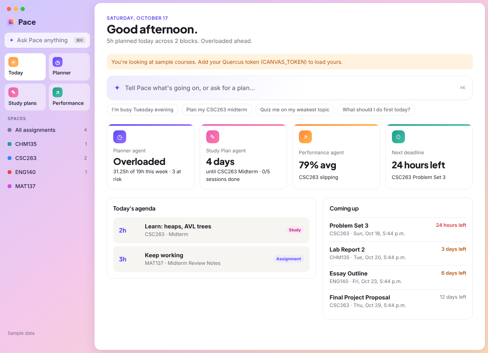
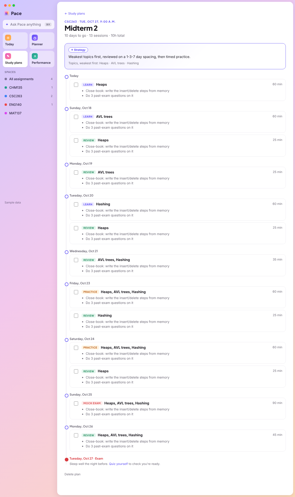
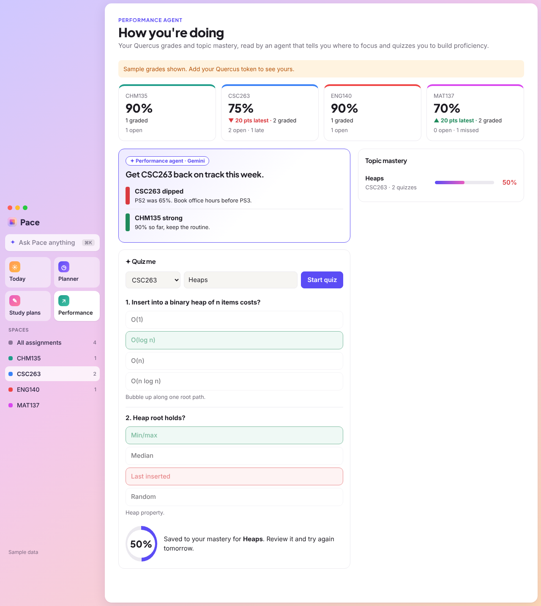
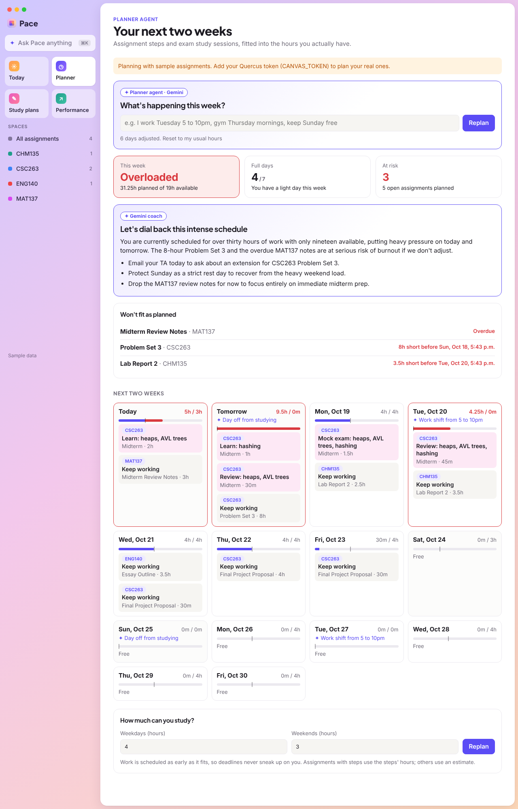
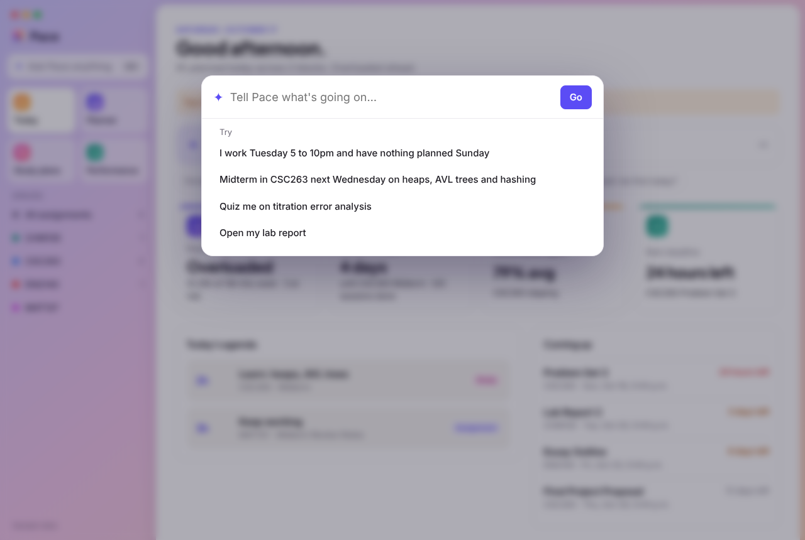
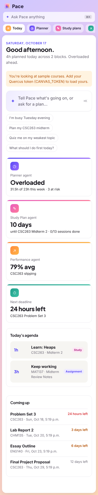

# Pace: your AI study team

Pace connects to Quercus (UofT's Canvas) and gives every student a small team of **AI agents, powered by Google Gemini**. They plan your week around your real life, build exam study timelines grounded in learning science, and measure how well you actually know each topic. Deadlines are only the starting point.

Built for **Hack the Valley 11**. Runs entirely on free tiers: Gemini API free tier, Vercel Hobby, Upstash free and Resend free.



## The agents

| Agent | What it does | How |
| --- | --- | --- |
| **Command bar** (⌘K) | One box for everything: "I work Tuesday 5 to 10", "Midterm in CSC263 on the 28th", "Quiz me on heaps". | Gemini **function calling** picks the right agent and extracts its arguments, then the app runs it. |
| **Planner** | Fits every assignment step and study session into the hours you have each day. Takes plain-English changes to your week. Flags crunch days, missing rest days and deadlines that won't fit, and writes a weekly coaching note. | Deterministic earliest-deadline-first scheduler in Toronto time. Gemini turns your message into per-day hour changes (structured output). |
| **Study Plan** | Builds a day-by-day timeline to an exam: learn each topic, review it 1, 3 and 7 days later, mixed timed practice, a mock exam two days out, and a light final review. Weakest topics go first. Sessions show up in your planner and the morning email. | Spaced-repetition scheduler. Gemini works out topics from your course if you don't list them and writes concrete activities for each session. |
| **Performance** | Reads your real Quercus grades per course (average, trend, late and missed work) and your topic mastery, then tells you where to focus. Quizzes you to measure proficiency, and the score feeds back into your study plans. | Gemini writes 5-question quizzes graded in the browser. Mastery is a weighted moving score per topic. Gemini writes insights from the numbers. |
| **Career agent** (Internships) | Tracks practicum, internship, co-op and conference applications. A list split into **Priority** (starred, soonest deadline first) and **By relevance** (ranked by fit with your background and location). Each opportunity gets a dated application plan (what to prioritize, which parts of your background to lead with, what's easy to miss) and a personalized cover letter. | Gemini structured output over your profile and the posting. Plan steps are dated back from the deadline with a two-day buffer. |
| **Scout** | Every morning it searches the web for internships, practicums and conferences that fit your profile, and checks the career sites you follow (GFT Technologies by default). New finds land in an inbox and the morning email, and nothing is added until you say so. | Gemini with **Google Search grounding** (free tier, 3 searches a day), run by a Vercel Cron job. Dead links fall back to the search source; expired postings and repeats are dropped. |
| **Assignment coach** | Breaks any assignment into steps with hour estimates and easy-to-miss requirements, finds resources, and answers questions from the instructor's instructions. | Gemini with JSON schemas over the Quercus description. |

Every agent has a rule-based fallback, so the app works without a key and never shows a blank screen in a demo.

| Study plan timeline | Performance and quiz |
| --- | --- |
|  |  |

| Planner | Command bar | Phone |
| --- | --- | --- |
|  |  |  |

## Career agent setup

Open **Internships → Profile & Scout settings** and fill in your program, skills, where you'd go and paste your resume as text. The Scout, fit scores, plans and cover letters all use it. Add any company whose careers page you want checked daily.

The Scout runs at 10:00 UTC (about 6am in Toronto) from `vercel.json`, before the 8am email, and uses the same `CRON_SECRET`. To run it by hand, use **Search now** on the Internships page. Without `GEMINI_API_KEY` the tracker, plans and letter templates still work, but the Scout can't search.

## Lecture notes from Granola

The Study plans page starts with a tile for each course. Open one to read that course's lecture notes: the summary, a link back to Granola, and the transcript when there is one.

- **With a Granola API key** (Business or Enterprise plan): in the Granola app, go to Settings → Connectors → API keys, create a key with the *Personal notes* scope and set it as `GRANOLA_API_KEY`. A note belongs to a course when it sits in a Granola folder whose name includes the course code (e.g. `CSC263`), or when its title mentions the code. Notes from the last six months are synced and cached for ten minutes.
- **Without a key**: on a course page, choose **Add a Granola note** and paste the summary (and the share link if you like). Pasted notes are saved with your other data.

## Design

The interface borrows from the Arc browser: a translucent sidebar on a soft gradient frame, the main content on a floating rounded panel, courses as coloured **Spaces**, pinned tiles for each agent, and a ⌘K command bar. It works in light and dark mode and on phones.

## Tech stack

- **Next.js 15** (App Router, React 19, TypeScript) on **Vercel**, with Vercel Cron for the 8am email
- **Google Gemini API** (`gemini-flash-latest`, free tier) over REST: structured JSON output and function calling
- **Canvas LMS REST API** for Quercus assignments, instructions, submissions and grades
- **Upstash Redis** for progress, steps, study plans, mastery, settings and an AI answer cache
- **Resend** for email, `sanitize-html` for instructor HTML

```
Quercus ─▶ canvas.ts ─▶ planner.ts (scheduler, burnout signals) ─▶ Today · Planner · email
                │              ▲            ▲
                ▼              │            │ study sessions
        agents/* ─▶ Gemini     │ steps      └── agents/study.ts (spaced repetition)
   router · planner · study · performance · ai.ts (assignment coach)
```

## Setup

1. **Quercus token**: Quercus → Account → Settings → *+ New access token*.
2. **Gemini key** (free, no billing needed): [aistudio.google.com/apikey](https://aistudio.google.com/apikey).
3. **Resend**: sign up with the address you want reminders at and create an API key.
4. **Vercel**: import this repo and add **Upstash for Redis** from the *Storage* tab.
5. **Environment variables** (tick Production): `CANVAS_TOKEN`, `GEMINI_API_KEY`, `APP_PASSWORD`, `RESEND_API_KEY`, `REMINDER_TO`, `CRON_SECRET`, `APP_URL`. Optional: `GEMINI_MODEL` (default `gemini-flash-latest`), `REMIND_DAYS`, `REMINDER_FROM`, `CANVAS_BASE_URL` (any Canvas school), `GRANOLA_API_KEY` (see below).
6. Redeploy.

## Local development

```
npm install
npm run dev
```

Without `CANVAS_TOKEN` it shows sample courses with grades; without Redis it saves to `.data/`; without `GEMINI_API_KEY` the agents use their rule-based fallbacks.
