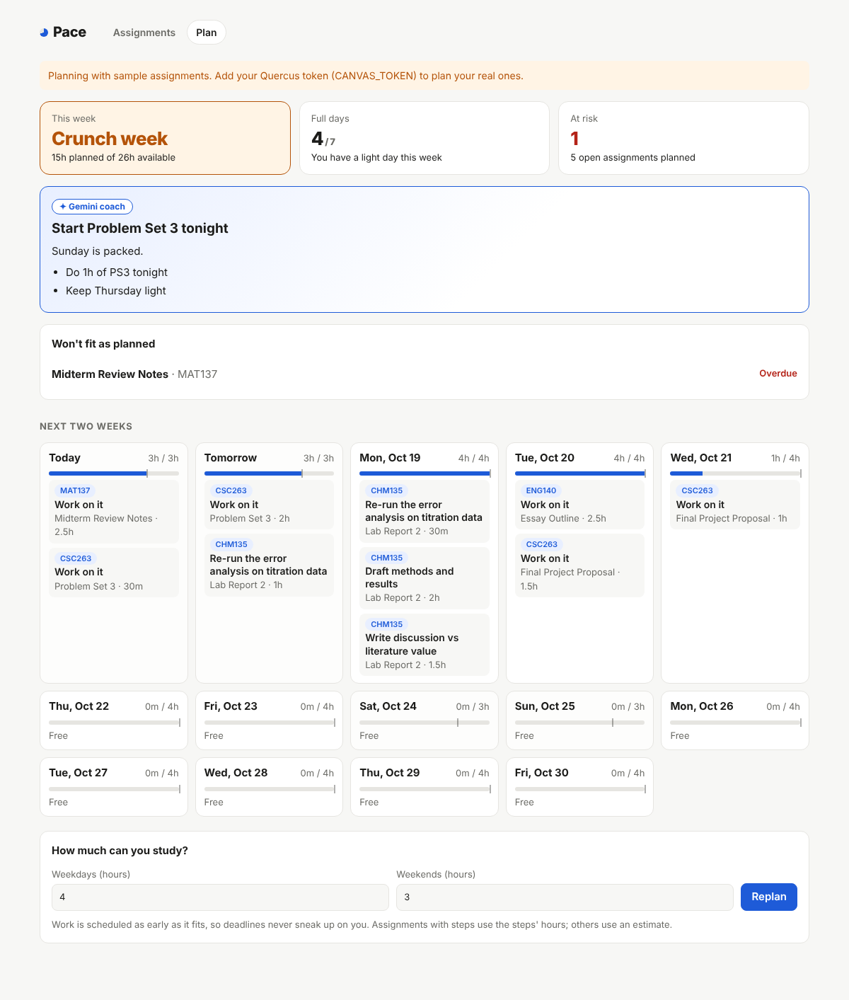
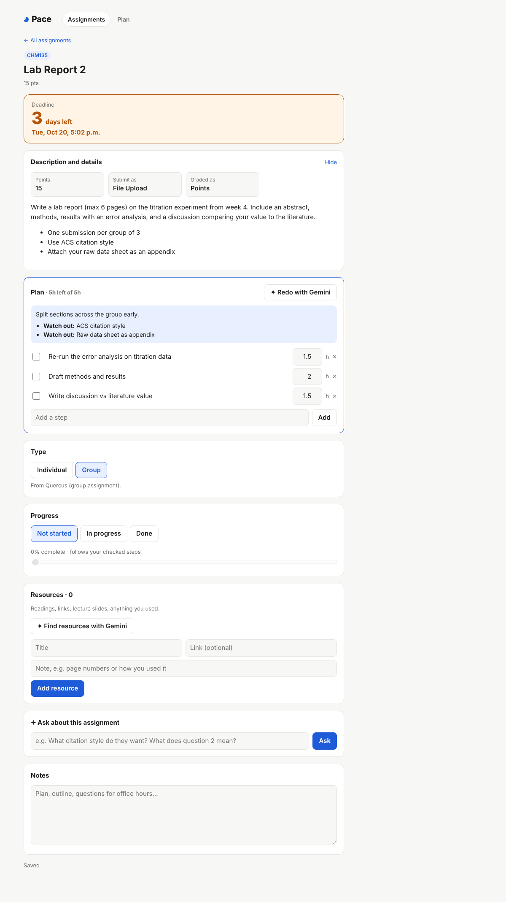
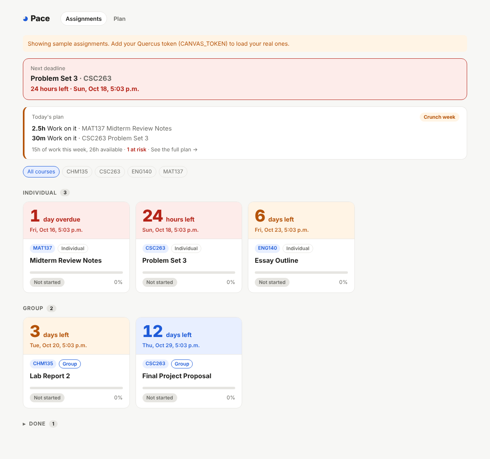

# Pace: your Quercus study coach

Pace pulls every assignment from Quercus (UofT's Canvas), uses **Google Gemini** to break each one into steps with time estimates, and schedules them into a week that fits the hours you actually have. It warns you about crunch days and deadlines that won't fit *before* they happen, and emails you each morning with today's plan.

Built for **Hack the Valley 11**.



## Why

Student burnout rarely comes from one hard assignment. It comes from five reasonable ones landing in the same week, noticed too late. Quercus tells you *when* things are due, never *how much work* they are or whether your week can hold it. Pace answers "what should I work on today, and is this week going to break me?"

## What it does

- **Live Quercus sync.** Every published assignment across your active courses: due dates, points, submission type, group or individual, the full instructions, and whether you've submitted.
- **✦ Break it down with Gemini.** Gemini reads the instructor's actual instructions and returns 3 to 8 specific steps with hour estimates, a one-line approach and the easy-to-miss requirements ("ACS citation style", "attach raw data as an appendix"). Checking steps off drives your progress.
- **Week planner.** A deterministic scheduler fits every remaining step into your daily study budget (weekday and weekend hours), earliest deadline first, as early as it fits.
- **Burnout signals.** A weekly status (calm, busy, crunch, overloaded), the number of full days, whether you still have a light day, and a list of assignments that won't fit before their deadline, with how many hours short you are.
- **✦ Gemini coach.** A short, specific note about your week: which day to protect, what to start tonight, when to ask for an extension.
- **✦ Estimate everything.** One Gemini call sizes every assignment you haven't broken down yet, so the plan is realistic from day one.
- **✦ Find resources.** Gemini picks out the key concepts in the instructions and turns them into video and scholarly searches, alongside links the instructor already put in Quercus. One click saves any of them to the assignment's resource list.
- **✦ Ask about this assignment.** Questions answered from the real instructions ("what citation style?"). It explains and plans; it won't write the graded work.
- **Morning email.** At 8am Toronto time: today's plan with hours, the week's status, at-risk work and everything due in the next few days.
- **Tracking.** Gallery of cards with big countdowns, group and individual sections, status, notes and a resource list per assignment.

Every Gemini feature has a rule-based fallback, so the app keeps working without a key or if the API is slow.

| Assignment page | Home |
| --- | --- |
|  |  |

## Tech stack

- **Next.js 15** (App Router, React 19, TypeScript) on **Vercel**, with Vercel Cron for the daily email
- **Google Gemini API** (`gemini-2.5-flash`) over REST with structured JSON output (response schemas)
- **Canvas LMS REST API** for Quercus data
- **Upstash Redis** for progress, steps, settings and a cache of AI answers
- **Resend** for email
- `sanitize-html` to safely render instructor HTML

```
Quercus API ──▶ lib/canvas.ts ──▶ lib/planner.ts (scheduler + burnout signals) ──▶ Plan page, Today strip, email
                     │                     ▲
                     ▼                     │ steps / hour estimates
               lib/ai.ts ──▶ Gemini (breakdown, estimates, coach, resources, Q&A)
```

## Setup

1. **Quercus token**: Quercus → Account → Settings → *+ New access token*.
2. **Gemini key**: create a free key at [aistudio.google.com/apikey](https://aistudio.google.com/apikey).
3. **Resend**: sign up at resend.com with the address you want reminders at, and create an API key.
4. **Deploy on Vercel**: import this repo and add **Upstash for Redis** from the *Storage* tab (sets `KV_REST_API_URL` and `KV_REST_API_TOKEN`).
5. **Environment variables** (tick **Production**):
   - `CANVAS_TOKEN`, `GEMINI_API_KEY`, `APP_PASSWORD`, `RESEND_API_KEY`, `REMINDER_TO`, `CRON_SECRET`, `APP_URL`
   - optional: `GEMINI_MODEL` (default `gemini-2.5-flash`), `REMIND_DAYS` (default 3), `REMINDER_FROM`, `CANVAS_BASE_URL` (default `https://q.utoronto.ca`)
6. Redeploy. Preview the email at `/api/cron/remind?preview=1` with header `Authorization: Bearer <CRON_SECRET>`.

## Local development

```
npm install
npm run dev
```

Without `CANVAS_TOKEN` it shows sample assignments; without Redis it saves to `.data/`; without `GEMINI_API_KEY` the AI features use simple rule-based plans.
